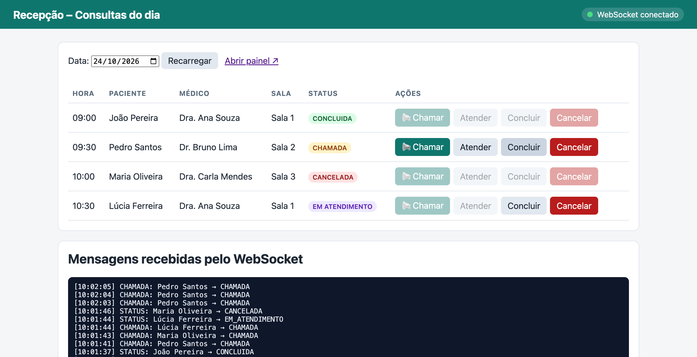
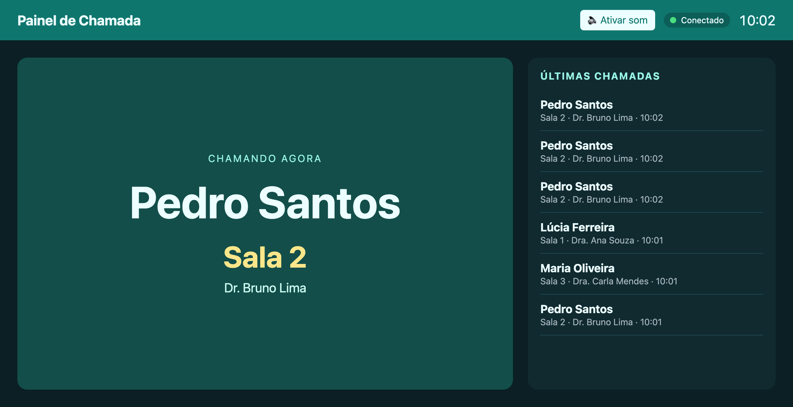

# Especificação da API – Clínica Médica (Agendamento de Consultas)

Disciplina: Desenvolvimento Web Back-end (BRADWBK) – IFSP Câmpus Bragança Paulista
Professor: Luiz Gustavo Diniz de Oliveira Véras
Estilo da API: RESTful + WebSocket

## 1. Integrantes do grupo

| Nome | Prontuário |
|---|---|
| (preencher) | (preencher) |
| (preencher) | (preencher) |

## 2. Domínio da aplicação

O sistema é o back-end de uma clínica médica. Ele permite cadastrar especialidades médicas, médicos, pacientes e agendar consultas. Também controla o fluxo de atendimento no dia da consulta: a recepção chama o paciente, o médico inicia o atendimento e depois o conclui.

Na sala de espera há um **painel de chamada** (uma TV) que mostra em tempo real, via WebSocket, o nome do paciente chamado e a sala para onde ele deve ir.

Tecnologias: Java 21, Spring Boot 3.5 (Spring Web, Spring Data JPA, Spring WebSocket, Bean Validation), Hibernate (ORM), banco relacional H2, Swagger/OpenAPI (springdoc), Postman/Newman para testes funcionais e Git para versionamento.

## 3. Requisitos funcionais da API

- **RF01** – Cadastrar, listar, consultar, atualizar e excluir especialidades médicas.
- **RF02** – Cadastrar, listar, consultar, atualizar e excluir médicos, informando CRM, contato, sala de atendimento e especialidades.
- **RF03** – Vincular e desvincular especialidades de um médico, e listar os médicos de uma especialidade.
- **RF04** – Cadastrar, listar, consultar, atualizar e excluir pacientes, com CPF único.
- **RF05** – Agendar, listar, consultar, reagendar e excluir consultas, ligando um médico a um paciente em uma data e hora.
- **RF06** – Filtrar consultas por data, médico, paciente e status.
- **RF07** – Listar as consultas de um médico (agenda) e o histórico de consultas de um paciente.
- **RF08** – Impedir que um médico ou um paciente tenha duas consultas no mesmo horário.
- **RF09** – Controlar o status da consulta: AGENDADA → CHAMADA → EM_ATENDIMENTO → CONCLUIDA, ou CANCELADA. Consultas concluídas ou canceladas não podem mais ser alteradas.
- **RF10** – Impedir a exclusão de médicos e pacientes que possuem consultas vinculadas.
- **RF11** – Responder erros em um formato padrão (status, mensagem e campos inválidos).

## 4. Requisito funcional com WebSocket

**RF-WS01 – Painel de chamada de pacientes em tempo real.** Quando a recepção chama um paciente (`POST /api/consultas/{id}/chamar`), o servidor envia uma mensagem pelo WebSocket `ws://localhost:8080/ws/painel` para todos os painéis conectados. A mensagem leva o nome do paciente, o médico e a sala. O painel mostra a chamada em destaque, guarda o histórico das últimas chamadas e pode tocar um aviso sonoro e falar o nome do paciente. Qualquer outra mudança de status da consulta também é enviada, para manter a tela da recepção atualizada sem recarregar a página.

Exemplo de mensagem enviada pelo servidor:

```json
{
  "tipo": "CHAMADA",
  "momento": "2026-11-10T09:31:05",
  "consulta": {
    "id": 2, "dataHora": "2026-11-10T09:30:00", "status": "CHAMADA", "observacoes": "Febre há 2 dias",
    "medico": { "id": 2, "nome": "Dr. Bruno Lima", "sala": "Sala 2" },
    "paciente": { "id": 3, "nome": "Pedro Santos" }
  }
}
```

Clientes web criados para a demonstração:

- `painel.html` – tela da sala de espera (TV), que recebe as chamadas.
- `recepcao.html` – lista as consultas do dia, tem os botões Chamar, Atender, Concluir e Cancelar, e mostra as mensagens recebidas pelo WebSocket.

## 5. Entidades e relacionamentos

| Entidade | Atributos |
|---|---|
| Especialidade | id, nome (único), descricao |
| Medico | id, nome, crm (único), email, telefone, sala |
| Paciente | id, nome, cpf (único), dataNascimento, telefone, email |
| Consulta | id, dataHora, status, observacoes, medico_id (FK), paciente_id (FK) |

Relacionamentos:

- **Médico ↔ Especialidade – Muitos-para-Muitos.** Um médico pode ter várias especialidades e uma especialidade pode ser atendida por vários médicos. A ligação fica na tabela associativa `medico_especialidade (medico_id, especialidade_id)`. No código, usa `@ManyToMany` com `@JoinTable` em `Medico` e `mappedBy` em `Especialidade`.
- **Médico → Consulta – Um-para-Muitos.** Um médico atende várias consultas e cada consulta pertence a um único médico (chave estrangeira `consulta.medico_id`). No código, usa `@OneToMany(mappedBy = "medico")` e `@ManyToOne`.
- **Paciente → Consulta – Um-para-Muitos.** Um paciente possui várias consultas e cada consulta pertence a um único paciente (chave estrangeira `consulta.paciente_id`).

Diagrama (resumo):

```
ESPECIALIDADE  N ────< medico_especialidade >──── N  MEDICO  1 ────< N  CONSULTA  N >──── 1  PACIENTE
```

## 6. Modelagem da API REST

URL base: `http://localhost:8080/api`. Documentação interativa (Swagger UI): `http://localhost:8080/swagger-ui.html`.

Formato padrão das respostas de erro:

```json
{ "timestamp": "2026-11-10T10:00:00", "status": 400, "erro": "Bad Request",
  "mensagem": "Dados inválidos na requisição", "path": "/api/pacientes",
  "campos": { "cpf": "deve estar no formato 000.000.000-00" } }
```

### 6.1 Especialidades

| Verbo HTTP | Path | Body de requisição | Body de retorno | Status de sucesso | Status de erro |
|---|---|---|---|---|---|
| GET | /especialidades | – | Lista de Especialidade | 200 | – |
| GET | /especialidades/{id} | – | Especialidade | 200 | 404 |
| GET | /especialidades/{id}/medicos | – | Lista de Medico | 200 | 404 |
| POST | /especialidades | `{ nome, descricao }` | Especialidade | 201 | 400, 409 (nome repetido) |
| PUT | /especialidades/{id} | `{ nome, descricao }` | Especialidade | 200 | 400, 404, 409 |
| DELETE | /especialidades/{id} | – | – | 204 | 404 |

Especialidade = `{ id, nome, descricao }`

### 6.2 Médicos

| Verbo HTTP | Path | Body de requisição | Body de retorno | Status de sucesso | Status de erro |
|---|---|---|---|---|---|
| GET | /medicos | – | Lista de Medico | 200 | – |
| GET | /medicos/{id} | – | Medico | 200 | 404 |
| POST | /medicos | `{ nome, crm, email, telefone, sala, especialidadeIds[] }` | Medico | 201 | 400, 404 (especialidade), 409 (CRM repetido) |
| PUT | /medicos/{id} | `{ nome, crm, email, telefone, sala, especialidadeIds[] }` | Medico | 200 | 400, 404, 409 |
| DELETE | /medicos/{id} | – | – | 204 | 404, 409 (possui consultas) |
| GET | /medicos/{id}/especialidades | – | Lista de Especialidade | 200 | 404 |
| POST | /medicos/{id}/especialidades/{especialidadeId} | – | Medico | 200 | 404 |
| DELETE | /medicos/{id}/especialidades/{especialidadeId} | – | – | 204 | 404, 409 (não vinculada) |
| GET | /medicos/{id}/consultas | – | Lista de Consulta | 200 | 404 |

Medico = `{ id, nome, crm, email, telefone, sala, especialidades: [Especialidade] }`

### 6.3 Pacientes

| Verbo HTTP | Path | Body de requisição | Body de retorno | Status de sucesso | Status de erro |
|---|---|---|---|---|---|
| GET | /pacientes | – | Lista de Paciente | 200 | – |
| GET | /pacientes/{id} | – | Paciente | 200 | 404 |
| POST | /pacientes | `{ nome, cpf, dataNascimento, telefone, email }` | Paciente | 201 | 400, 409 (CPF repetido) |
| PUT | /pacientes/{id} | `{ nome, cpf, dataNascimento, telefone, email }` | Paciente | 200 | 400, 404, 409 |
| DELETE | /pacientes/{id} | – | – | 204 | 404, 409 (possui consultas) |
| GET | /pacientes/{id}/consultas | – | Lista de Consulta | 200 | 404 |

Paciente = `{ id, nome, cpf, dataNascimento, telefone, email }`

### 6.4 Consultas

| Verbo HTTP | Path | Body de requisição | Body de retorno | Status de sucesso | Status de erro |
|---|---|---|---|---|---|
| GET | /consultas?data=&medicoId=&pacienteId=&status= | – | Lista de Consulta | 200 | 400 (filtro inválido) |
| GET | /consultas/{id} | – | Consulta | 200 | 404 |
| POST | /consultas | `{ dataHora, medicoId, pacienteId, observacoes }` | Consulta | 201 | 400, 404 (médico/paciente), 409 (horário ocupado) |
| PUT | /consultas/{id} | `{ dataHora, medicoId, pacienteId, observacoes }` | Consulta | 200 | 400, 404, 409 |
| DELETE | /consultas/{id} | – | – | 204 | 404 |
| PATCH | /consultas/{id}/status | `{ status }` | Consulta | 200 | 400, 404, 409 (consulta finalizada) |
| POST | /consultas/{id}/chamar | – | Consulta | 200 | 404, 409 (status não permite) |

Consulta = `{ id, dataHora, status, observacoes, medico: { id, nome, sala }, paciente: { id, nome } }`
Os endpoints `PATCH /status` e `POST /chamar` enviam o evento para o WebSocket `/ws/painel`.

### 6.5 WebSocket

| Endpoint | Direção | Mensagem | Quando |
|---|---|---|---|
| ws://localhost:8080/ws/painel | Servidor → clientes | `{ tipo: "CHAMADA", momento, consulta }` | Paciente chamado |
| ws://localhost:8080/ws/painel | Servidor → clientes | `{ tipo: "STATUS", momento, consulta }` | Outra mudança de status |
| ws://localhost:8080/ws/painel | Cliente → servidor | `ping` (resposta: `pong`) | Teste de conexão |

## 7. Testes funcionais

Os testes foram feitos no Postman com a coleção `postman/clinica-api.postman_collection.json`. São 46 requisições com 82 verificações automáticas, que cobrem o CRUD das 4 entidades, os dois relacionamentos, o fluxo de atendimento e os casos de erro (400, 404 e 409).

(Inserir aqui os prints do Postman: Collection Runner com todos os testes aprovados e exemplos de requisições de cada entidade.)

Demonstração do WebSocket: ao clicar em "Chamar" na recepção, o painel recebe a chamada na hora.




